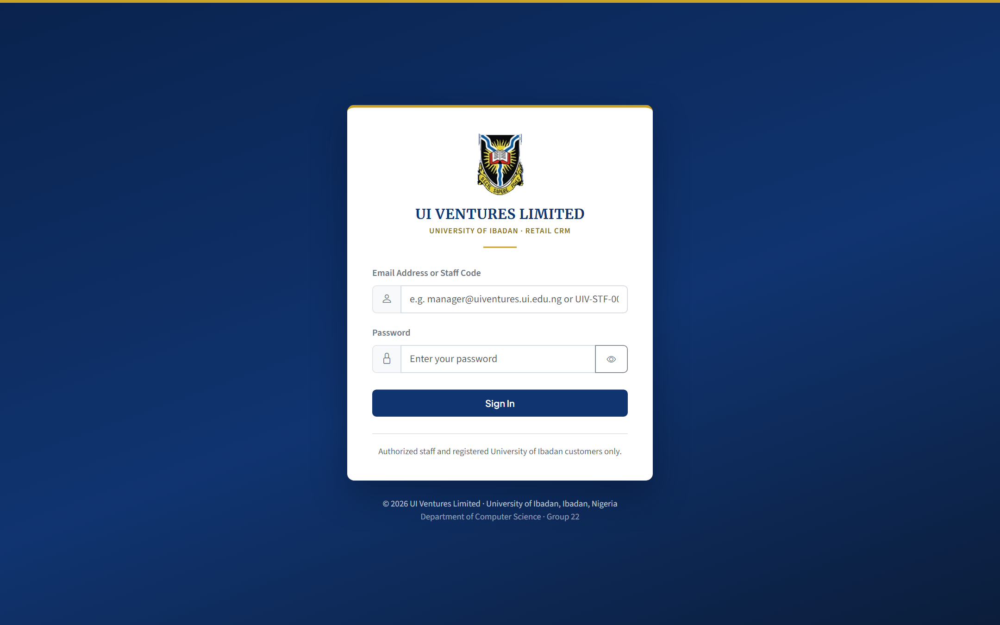
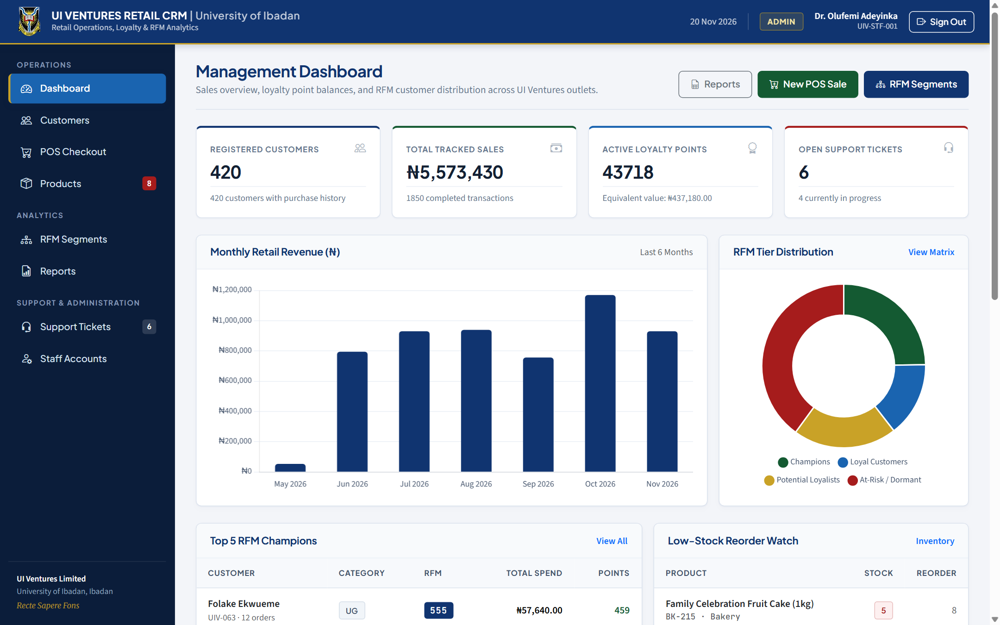
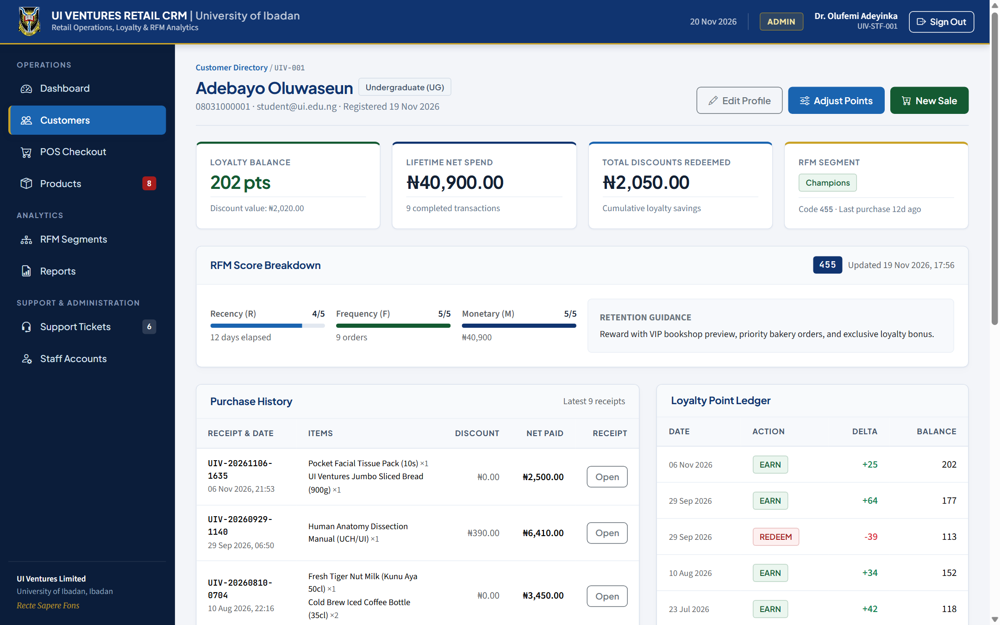
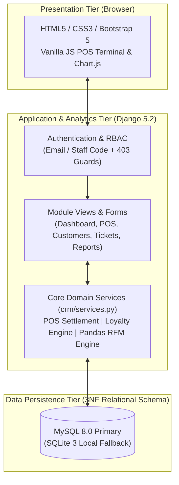
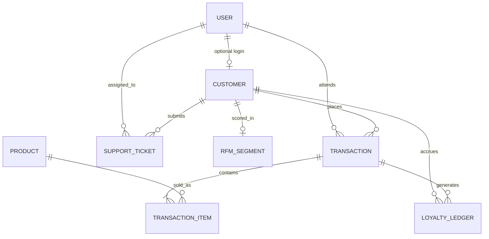

<div align="center">
  
  <h1>UI Ventures Retail CRM &amp; RFM Analytics System</h1>
  <p>
    <strong>Department of Computer Science, University of Ibadan</strong><br />
    Final Year Software Implementation Project (Group 22)
  </p>
  <p>
    Python 3.11+ &middot; Django 5.2 &middot; MySQL 8.0 / SQLite &middot; Bootstrap 5 &middot; Chart.js &middot; pandas &middot; pytest
  </p>
</div>

---

## 1. Project Overview

The **UI Ventures Retail CRM System** is a full-stack web application developed for the retail operations of **UI Ventures Limited, University of Ibadan** (covering the Campus Bookshop, Stationery, Bakery, Beverages, and Consumables outlets).

The application centralizes customer registration, Point-of-Sale (POS) transaction settlement, loyalty point accrual and redemption, quintile-based **Recency-Frequency-Monetary (RFM)** customer segmentation, customer support ticket tracking, and CSV reporting under role-based access control.

---

## 2. Live Access & Interface Preview

### Running the Application Online
You can run and test the live application directly in a browser without installing Python locally:

- **GitHub Codespaces:** Open **[Launch in GitHub Codespaces](https://codespaces.new/Ahamefuna/ui-ventures-retail-crm)**. The included [`.devcontainer/devcontainer.json`](.devcontainer/devcontainer.json) installs dependencies, applies migrations, runs `seed_uiventures`, starts the Django server on port `8000`, and opens the site in your browser.
- **Render Cloud Deployment:** Deploy a public HTTPS instance via **[Deploy on Render](https://render.com/deploy?repo=https://github.com/Ahamefuna/ui-ventures-retail-crm)** using [`render.yaml`](render.yaml) and [`build.sh`](build.sh).

*(Sign in using any of the evaluation accounts in [Section 9](#9-seeded-dataset--demo-accounts) with password `Password123!`.)*

### Application Screenshots

#### Sign-In Portal


#### Management Dashboard (KPIs, Monthly Revenue & RFM Distribution)


#### Point of Sale (POS) Checkout & Loyalty Point Redemption


#### RFM Customer Segmentation & Retention Matrix


#### Customer Profile, RFM Breakdown & Loyalty Ledger


#### Customer Self-Service Portal (`student@ui.edu.ng`)


---

## 3. System Architecture

The application follows a three-tier client-server architecture built with Django's Model-View-Template (MVT) pattern:



---

## 4. Relational Database Schema (3NF)

The database is normalized to Third Normal Form across **8 relational tables** defined in [`crm/models.py`](crm/models.py), enforcing foreign-key constraints, unique identifiers, and composite indexes:

| Table | Model | Purpose & Key Constraints |
| :--- | :--- | :--- |
| `crm_user` | `User` | Custom `AbstractUser` (`email` unique login ID, nullable unique `staff_code`, `role` in `Admin`, `Manager`, `Attendant`, `Customer`) |
| `crm_customer` | `Customer` | Campus customer registry (`cust_code` e.g. `UIV-001`, unique `phone`, `category`, live `loyalty_points`, optional 1:1 `user`) |
| `crm_product` | `Product` | Retail catalog (`sku_code`, `category`, `unit_price`, `stock_qty`, `reorder_level`) |
| `crm_transaction` | `Transaction` | Completed POS headers (`receipt_no`, `customer`, `attended_by`, `gross_amount`, `discount_amount`, `net_amount`, `payment_ref`) |
| `crm_transaction_item` | `TransactionItem` | Itemized line records preserving `unit_price_at_sale`, `quantity`, and `line_subtotal` |
| `crm_loyalty_ledger` | `LoyaltyLedger` | Immutable audit log of `EARN`, `REDEEM`, and `ADJUST` point deltas with running `balance_after` |
| `crm_rfm_segment` | `RFMSegment` | 1:1 customer RFM metrics (`recency_days`, `frequency_count`, `monetary_total`, `r/f/m_score`, `tier_label`) |
| `crm_support_ticket` | `SupportTicket` | Customer inquiries, loyalty disputes, damaged items, and feedback (`Open` -> `In_Progress` -> `Resolved`) |



---

## 5. Core Business Logic & Algorithms

Core retail and analytical logic is implemented in [`crm/services.py`](crm/services.py):

### A. Atomic POS Settlement & Loyalty Engine (`settle_retail_transaction`)
Wrapped in `@transaction.atomic` with row-level locking (`select_for_update()`):
- **Stock Validation:** Aggregates duplicate cart SKUs, verifies `stock_qty >= quantity`, and rolls back the entire transaction if stock is insufficient.
- **Loyalty Point Redemption:** `1 point = ₦10.00` discount. Redemptions are bounded by both the customer's available balance and a **50% cap on `gross_amount`**.
- **Loyalty Point Accrual:** `POINT_EARN_RATE = 0.01` (1 loyalty point per `₦100` of net spend, floored to an integer).
- **Ledger Integrity:** Records separate immutable `REDEEM` and `EARN` entries in `LoyaltyLedger` whenever both occur on the same sale.

### B. Quintile RFM Segmentation (`compute_rfm_segments`)
Implemented using `pandas` over all customers with at least one completed transaction:
- Calculates raw Recency (`recency_days`), Frequency (`frequency_count`), and Monetary (`monetary_total`).
- Assigns quintile scores (`1-5`) via `pd.qcut(series.rank(method="first"), 5)` with reversed Recency labels `[5, 4, 3, 2, 1]` and ascending `[1, 2, 3, 4, 5]` for Frequency and Monetary.
- Persists retention tiers using `RFMSegment.objects.update_or_create(...)`:

| Retention Tier | Classification Rule | Operational Action |
| :--- | :--- | :--- |
| **Champions** | `R >= 4 and F >= 4 and M >= 4` | VIP bookshop previews, priority bakery orders, exclusive bonus rewards |
| **Loyal Customers** | `R >= 3 and F >= 3 and M >= 3` | Semester stationery bundles and referral incentives |
| **Potential Loyalists** | `R >= 3 and F <= 2` | Welcome-back coupons highlighting point redemption benefits |
| **At-Risk / Dormant** | All remaining customers | Win-back retention alerts with time-limited bonus points |

---

## 6. Role-Based Access Control (RBAC)

Enforced in [`crm/decorators.py`](crm/decorators.py) (`HTTP 403 Forbidden` for unauthorized authenticated users; redirect to `/login/` for unauthenticated requests):

| Route | Module | Admin | Manager | Attendant | Customer |
| :--- | :--- | :---: | :---: | :---: | :---: |
| `/dashboard/` | Management Dashboard & Charts | Allowed | Allowed | 403 | 403 |
| `/customers/` | Customer Directory & Profiles | Allowed | Allowed | Allowed | 403 |
| `/pos/` | POS Checkout Terminal | Allowed | Allowed | Allowed | 403 |
| `/receipt/<id>/` | Printable Digital Receipt | Allowed | Allowed | Allowed | Own Only |
| `/rfm/` | RFM Matrix & Retention Alerts | Allowed | Allowed | 403 | 403 |
| `/reports/` | Sales Reports & CSV Exports | Allowed | Allowed | 403 | 403 |
| `/products/` | Product Catalog & Inventory | Allowed | Allowed | 403 | 403 |
| `/staff/` | Staff & Role Administration | Allowed | 403 | 403 | 403 |
| `/tickets/` | Customer Support Desk | All | All | All | Own Only |
| `/my-portal/` | Customer Self-Service Portal | 403 | 403 | 403 | Allowed |

---

## 7. Project Structure

```text
.
├── manage.py
├── requirements.txt
├── pytest.ini
├── .env.example
├── render.yaml / build.sh / Procfile
├── .devcontainer/devcontainer.json
├── docs/screenshots/
├── uiventures_crm/
│   ├── settings.py          # MySQL 8.0 primary config + SQLite fallback + WhiteNoise
│   ├── urls.py
│   └── wsgi.py
└── crm/
    ├── models.py            # 8-table 3NF relational schema
    ├── services.py          # Atomic POS engine, loyalty rules, pandas RFM engine
    ├── views.py             # Views for all 9 modules + CSV exports
    ├── forms.py             # Validation forms for auth, customers, products, staff, tickets
    ├── backends.py          # Dual login backend (Email or Staff Code)
    ├── decorators.py        # Role-based access control (403 enforcement)
    ├── context_processors.py
    ├── templatetags/crm_tags.py
    ├── management/commands/seed_uiventures.py
    ├── static/crm/          # Institutional stylesheet, UI crest asset, POS terminal JS
    ├── templates/crm/       # Responsive Bootstrap 5 templates & printable receipt
    └── tests/               # Pytest unit & integration test suite (14 tests)
```

---

## 8. Local Setup & Installation

### Prerequisites
- Python 3.11+
- Optional: MySQL 8.0 (defaults to local SQLite when `USE_MYSQL=False`)

### Installation Steps
```bash
# 1. Clone the repository
git clone https://github.com/Ahamefuna/ui-ventures-retail-crm.git
cd ui-ventures-retail-crm

# 2. Create and activate a virtual environment
python -m venv venv
# Windows (PowerShell):
.\venv\Scripts\Activate.ps1
# macOS / Linux:
source venv/bin/activate

# 3. Install dependencies
pip install -r requirements.txt

# 4. (Optional) Configure MySQL 8.0
# Copy .env.example to .env and set USE_MYSQL=True with your DB credentials

# 5. Run migrations and seed the dataset
python manage.py migrate
python manage.py seed_uiventures

# 6. Start the development server
python manage.py runserver
```

Open **`http://127.0.0.1:8000/login/`** in your browser.

---

## 9. Seeded Dataset & Demo Accounts

Running `python manage.py seed_uiventures` (idempotent) populates University of Ibadan retail data:
- **420** registered campus customers (`UG`, `PG`, `Academic`, `Non-Teaching`, `Visitor`)
- **85** UI Ventures retail products (`Books`, `Stationery`, `Bakery`, `Beverages`, `Consumables`)
- **1,850** itemized transactions across the past 6 months (~`₦5.57M` net revenue) with `2,147` `LoyaltyLedger` records
- **420** computed `RFMSegment` classifications across all four retention tiers
- **15** `SupportTicket` records spanning `Open`, `In_Progress`, and `Resolved` states

### Evaluation Credentials
Password for all demo accounts: **`Password123!`**

| Role | Email Address | Staff Code | Default Landing Route |
| :--- | :--- | :--- | :--- |
| **Admin** | `admin@uiventures.ui.edu.ng` | `UIV-STF-001` | `/dashboard/` |
| **Store Manager** | `manager@uiventures.ui.edu.ng` | `UIV-STF-002` | `/dashboard/` |
| **Sales Attendant** | `attendant@uiventures.ui.edu.ng` | `UIV-STF-003` | `/pos/` |
| **Customer** | `student@ui.edu.ng` | N/A | `/my-portal/` |

---

## 10. Automated Testing

Run the unit and integration test suite with `pytest`:

```bash
pytest -v
```

| Test Module | Verification Scope | Status |
| :--- | :--- | :---: |
| [`crm/tests/test_pos_loyalty.py`](crm/tests/test_pos_loyalty.py) | Atomic checkout, stock deduction & rollback, 1% accrual, 50% redemption cap, balance limits, printable receipt | 6 Passed |
| [`crm/tests/test_rfm.py`](crm/tests/test_rfm.py) | Quintile scoring (`R` reversed, `F`/`M` ascending), strict 4-tier classification, retention alert dispatch | 2 Passed |
| [`crm/tests/test_rbac.py`](crm/tests/test_rbac.py) | Dual Email/Staff-Code login and 403 enforcement across Admin, Manager, Attendant, and Customer roles | 4 Passed |
| [`crm/tests/test_tickets.py`](crm/tests/test_tickets.py) | Ticket lifecycle (`Open` -> `In_Progress` -> `Resolved`) and customer ticket isolation | 2 Passed |

---

## 11. Cloud Deployment

Production deployment files ([`render.yaml`](render.yaml), [`build.sh`](build.sh), and [`Procfile`](Procfile)) configured with `gunicorn` and `whitenoise` are included for deployment to Render or any standard WSGI server.
