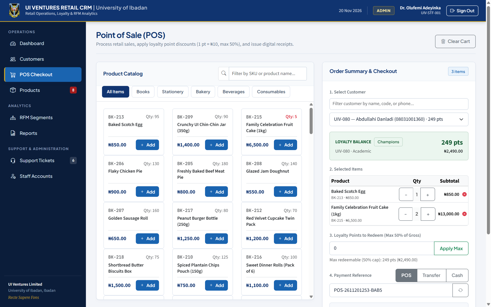
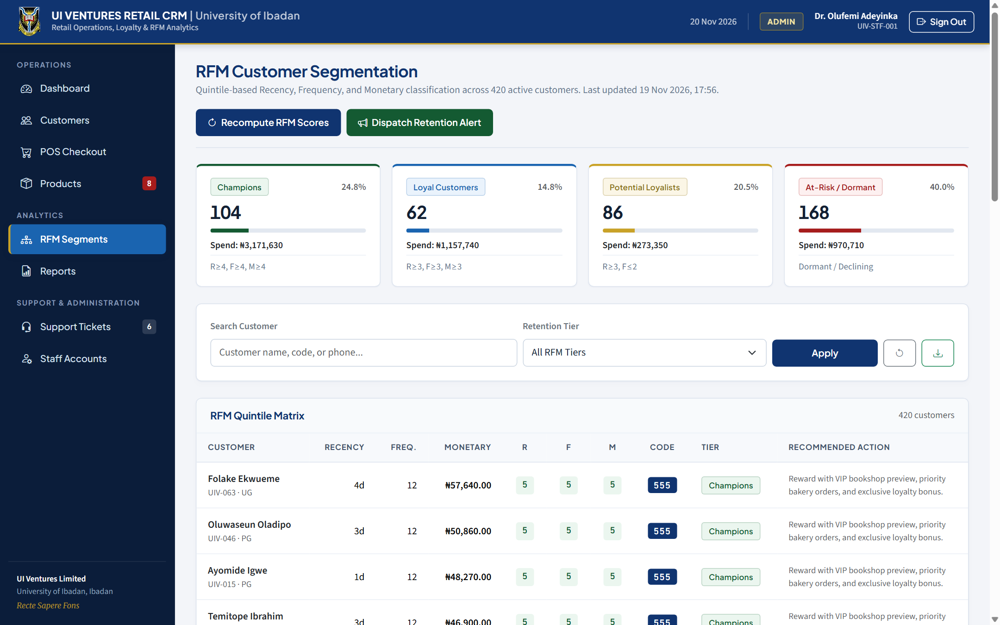
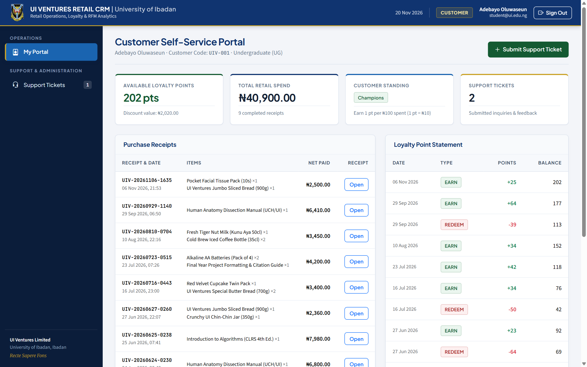
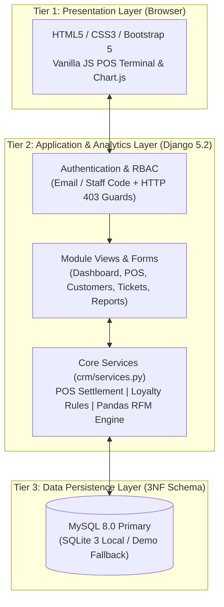
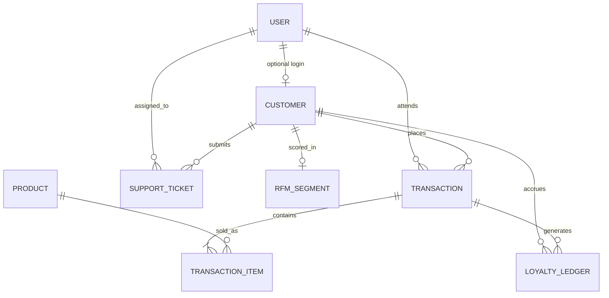

<div align="center">
  
  <h1>UI Ventures Retail CRM System</h1>
  <p>
    <strong>Customer Relationship Management System for a Retail Store</strong><br />
    <em>Case Study: UI Ventures Limited, University of Ibadan</em>
  </p>
  <p>
    <strong>CSC 476 (Research Methods in Computer Science) &middot; Group 22 (2025/2026 Session)</strong><br />
    Department of Computer Science, Faculty of Science, University of Ibadan
  </p>
  <p>
    <strong>Live Website:</strong> <a href="https://ui-ventures-retail-crm.vercel.app/login/">https://ui-ventures-retail-crm.vercel.app/login/</a>
  </p>
</div>

---

## 1. Live Application & Login Guide

The web application is hosted live on Vercel and pre-loaded with the evaluation dataset (`420` campus customers, `85` UI Ventures retail items, `1,850` itemized receipts, `420` RFM customer classifications, and `15` support tickets). No local installation is needed to test it.

### How to Test the Live Site
1. Open the live login portal: **[https://ui-ventures-retail-crm.vercel.app/login/](https://ui-ventures-retail-crm.vercel.app/login/)**
2. Sign in with any of the four role accounts in the table below (staff accounts accept either their email address or staff code).
3. Use the left sidebar to inspect the modules available to that role, then click **Sign Out** to test another role and verify access restrictions.

### Evaluation Login Accounts
**Password for all accounts:** `Password123!`

| Role | Email Address | Staff Code | Landing Page | What You Can Inspect |
| :--- | :--- | :--- | :--- | :--- |
| **Admin** | `admin@uiventures.ui.edu.ng` | `UIV-STF-001` | `/dashboard/` | Full access: KPI summary, monthly revenue chart, RFM matrix, customer directory, POS checkout, inventory, CSV reports, staff accounts, support tickets |
| **Store Manager** | `manager@uiventures.ui.edu.ng` | `UIV-STF-002` | `/dashboard/` | Analytical dashboard, RFM recalculation and retention alerts, product catalog, CSV exports, POS, customers, support tickets (no `/staff/` access) |
| **Sales Attendant** | `attendant@uiventures.ui.edu.ng` | `UIV-STF-003` | `/pos/` | Counter POS checkout cart, loyalty point redemption, printable receipts, customer lookup, support tickets (`/dashboard/`, `/rfm/`, and `/reports/` return HTTP 403) |
| **Customer** | `student@ui.edu.ng` | — | `/my-portal/` | Personal loyalty point balance, purchase history, printable receipts, and personal support ticket submission and tracking |

---

## 2. Project Summary & Group 22 Details

Retail counters at **UI Ventures Limited, University of Ibadan** (covering the University Bookshop, Stationery, Bakery, Beverages, and Consumables units) serve returning students and staff every semester, yet daily sales are recorded anonymously without linking receipts to customer accounts, awarding loyalty points, grouping repeat shoppers, or tracking product complaints systematically.

This Django web application addresses those four operational gaps by combining:
- Centralized campus customer registration and purchase history lookup
- Counter Point-of-Sale (POS) checkout with atomic stock updates and itemized receipts
- Rule-based loyalty point accrual (`1 point` per `₦100` net spend) and redemption (`1 point = ₦10`, capped at `50%` of the gross bill)
- Automated quintile-based **Recency, Frequency, and Monetary (RFM)** customer segmentation using `pandas`
- Status-tracked customer support tickets (`Open` -> `In_Progress` -> `Resolved`) and CSV reporting

**Course:** CSC 476 (Research Methods in Computer Science)  
**Lecturer / Supervisor:** Prof. B. F. Oladejo  
**Technology Stack:** Python 3.11+, Django 5.2, MySQL 8.0 (SQLite local/demo fallback), Bootstrap 5, Chart.js, pandas, pytest

### Group 22 Members

| S/N | Full Name | Matric. No. | Role |
| :---: | :--- | :---: | :--- |
| 1 | **ONYISHI, Christian** | `E051546` | Team Leader |
| 2 | MAKANJUOLA, Samuel | `E051547` | Group Member |
| 3 | OLORUNTOLA, Oluwatobiloba | `E051549` | Group Member |
| 4 | OLOYEDE, Mubarak | `E051551` | Group Member |
| 5 | AYORINDE, Omolayo | `E051552` | Group Member |

---

## 3. Application Screenshots

### 3.1 Role-Based Login Portal (`/login/`)
Staff sign in with their institutional email or staff code; registered customers sign in with their email address and are routed automatically to their permitted workspace.


### 3.2 Management Dashboard (`/dashboard/`)
Displays live totals for registered customers, net revenue, active loyalty points, and open support tickets alongside a monthly revenue bar chart and RFM tier distribution chart.


### 3.3 Counter POS Checkout & Loyalty Redemption (`/pos/`)
Allows attendants to select a registered shopper, add retail items to the cart, apply loyalty point discounts within the 50% gross cap, deduct inventory, and issue a printable receipt.



### 3.4 RFM Customer Segmentation Matrix (`/rfm/`)
Groups customers into Champions, Loyal Customers, Potential Loyalists, and At-Risk / Dormant tiers based on quintile scores (`1-5`) and logs targeted retention alerts.



### 3.5 Customer Profile & Loyalty Ledger (`/customers/<id>/`)
Shows a shopper's personal details, current RFM scores, itemized transaction receipts, and the full immutable ledger of earned and redeemed loyalty points.


### 3.6 Customer Self-Service Portal (`/my-portal/`)
Lets registered University of Ibadan students and staff check their loyalty balance, view past receipts, and submit or monitor support tickets.



---

## 4. System Architecture & 3NF Database Design

The application follows a three-tier client-server design built on Django's Model-View-Template (MVT) architecture:



The relational schema in [`crm/models.py`](crm/models.py) is normalized to Third Normal Form (3NF) across 8 tables:

| Table | Model | Key Columns & Constraints |
| :--- | :--- | :--- |
| `crm_user` | `User` | Custom `AbstractUser` with unique `email`, nullable unique `staff_code`, and `role` (`Admin`, `Manager`, `Attendant`, `Customer`) |
| `crm_customer` | `Customer` | Unique `cust_code` (e.g. `UIV-001`), unique `phone`, campus `category`, live `loyalty_points`, optional 1:1 `user` link |
| `crm_product` | `Product` | Unique `sku_code`, `category`, `unit_price`, `stock_qty`, `reorder_level` |
| `crm_transaction` | `Transaction` | Unique `receipt_no`, `customer`, `attended_by`, `gross_amount`, `discount_amount`, `net_amount`, `payment_ref` |
| `crm_transaction_item` | `TransactionItem` | Line items preserving `unit_price_at_sale`, `quantity`, and `line_subtotal` |
| `crm_loyalty_ledger` | `LoyaltyLedger` | Immutable audit entries (`EARN`, `REDEEM`, `ADJUST`) recording `points_delta` and `balance_after` |
| `crm_rfm_segment` | `RFMSegment` | 1:1 computed metrics (`recency_days`, `frequency_count`, `monetary_total`, `r/f/m_score`, `tier_label`) |
| `crm_support_ticket` | `SupportTicket` | Unique `ticket_code`, category, subject, status (`Open`, `In_Progress`, `Resolved`), `assigned_to`, `resolution_note` |



---

## 5. Core Business Logic (`crm/services.py`)

### 5.1 Atomic POS Checkout & Loyalty Rules (`settle_retail_transaction`)
Executed inside `@transaction.atomic` with `select_for_update()` row locking:
- Validates available stock across all cart items and rolls back completely if any item has insufficient stock.
- Values redeemed points at `₦10.00` per point, limited by both the customer's balance and a maximum of `50%` of `gross_amount`.
- Credits new loyalty points at `1%` of `net_amount` (`1 point` per `₦100` spent, floored to an integer).
- Writes separate immutable `REDEEM` and `EARN` rows in `LoyaltyLedger` whenever a transaction includes both.

### 5.2 Quintile RFM Segmentation (`compute_rfm_segments`)
Uses `pandas` over all customers with completed transactions:
- Computes Recency (`recency_days`), Frequency (`frequency_count`), and Monetary total (`monetary_total`).
- Assigns quintile scores (`1` to `5`) using `pd.qcut(series.rank(method="first"), 5)` with reversed labels `[5, 4, 3, 2, 1]` for Recency and ascending labels `[1, 2, 3, 4, 5]` for Frequency and Monetary.
- Maps each customer to a retention tier:

| Retention Tier | Rule | Recommended Action |
| :--- | :--- | :--- |
| **Champions** | `R >= 4 and F >= 4 and M >= 4` | VIP bookshop previews, priority bakery orders, bonus point rewards |
| **Loyal Customers** | `R >= 3 and F >= 3 and M >= 3` | Semester stationery bundles and referral incentives |
| **Potential Loyalists** | `R >= 3 and F <= 2` | Welcome-back coupons highlighting loyalty point savings |
| **At-Risk / Dormant** | All other customers | Win-back retention alerts with time-limited bonus points |

---

## 6. Role-Based Access Control (`crm/decorators.py`)

Unauthorized authenticated requests receive a branded `HTTP 403 Forbidden` response; unauthenticated requests redirect to `/login/`.

| Route | Module | Admin | Manager | Attendant | Customer |
| :--- | :--- | :---: | :---: | :---: | :---: |
| `/dashboard/` | Management Dashboard & Charts | Allowed | Allowed | 403 | 403 |
| `/customers/` | Customer Directory & Profiles | Allowed | Allowed | Allowed | 403 |
| `/pos/` | POS Checkout Terminal | Allowed | Allowed | Allowed | 403 |
| `/receipt/<id>/` | Printable Digital Receipt | Allowed | Allowed | Allowed | Own Only |
| `/rfm/` | RFM Matrix & Retention Alerts | Allowed | Allowed | 403 | 403 |
| `/reports/` | Sales Reports & CSV Exports | Allowed | Allowed | 403 | 403 |
| `/products/` | Product Catalog & Inventory | Allowed | Allowed | 403 | 403 |
| `/staff/` | Staff & Role Administration | Allowed | 403 | 403 | 403 |
| `/tickets/` | Customer Support Desk | All | All | All | Own Only |
| `/my-portal/` | Customer Self-Service Portal | 403 | 403 | 403 | Allowed |

---

## 7. Repository Structure

```text
.
├── manage.py
├── requirements.txt
├── pytest.ini
├── .env.example
├── vercel.json                        # Live Vercel WSGI deployment config
├── render.yaml / build.sh / Procfile  # Alternative Render / WSGI deployment files
├── .devcontainer/devcontainer.json    # Optional GitHub Codespaces setup
├── docs/screenshots/                  # Captured interface screenshots
├── uiventures_crm/
│   ├── settings.py                    # MySQL 8.0 primary config + SQLite fallback + Vercel settings
│   ├── urls.py
│   └── wsgi.py
└── crm/
    ├── models.py                      # 8-table 3NF relational schema
    ├── services.py                    # Atomic POS engine, loyalty rules, pandas RFM engine
    ├── views.py                       # Views for all modules and CSV exports
    ├── forms.py                       # Input validation forms
    ├── backends.py                    # Email or Staff Code login backend
    ├── decorators.py                  # Role-based access control guards
    ├── context_processors.py
    ├── data/demo.sqlite3              # Pre-seeded demo database snapshot for live hosting
    ├── templatetags/crm_tags.py
    ├── management/commands/seed_uiventures.py
    ├── static/crm/                    # Stylesheet, University of Ibadan crest, POS JS
    ├── templates/crm/                 # Responsive Bootstrap 5 templates and receipt view
    └── tests/                         # Automated pytest suite (14 tests)
```

---

## 8. Local Setup & Automated Tests

To run the project locally on any machine with Python 3.11+:

```bash
git clone https://github.com/Ahamefuna/ui-ventures-retail-crm.git
cd ui-ventures-retail-crm

python -m venv venv
# Windows (PowerShell):
.\venv\Scripts\Activate.ps1
# macOS / Linux:
source venv/bin/activate

pip install -r requirements.txt
python manage.py migrate
python manage.py seed_uiventures
python manage.py runserver
```

Then open `http://127.0.0.1:8000/login/` in your browser. To connect MySQL 8.0 instead of the default SQLite database, copy `.env.example` to `.env`, set `USE_MYSQL=True`, and fill in your MySQL credentials.

### Automated Verification (`pytest`)
Run the full unit and integration test suite with:

```bash
pytest -v
```

| Test File | Scope Verified | Result |
| :--- | :--- | :---: |
| [`crm/tests/test_pos_loyalty.py`](crm/tests/test_pos_loyalty.py) | Atomic checkout, stock deduction and rollback, 1% point accrual, 50% redemption cap, balance validation, receipt rendering | 6 Passed |
| [`crm/tests/test_rfm.py`](crm/tests/test_rfm.py) | Quintile scoring (`R` reversed, `F`/`M` ascending), 4-tier classification, retention alert logging | 2 Passed |
| [`crm/tests/test_rbac.py`](crm/tests/test_rbac.py) | Dual Email/Staff-Code login and HTTP 403 enforcement across all four user roles | 4 Passed |
| [`crm/tests/test_tickets.py`](crm/tests/test_tickets.py) | Ticket lifecycle (`Open` -> `In_Progress` -> `Resolved`) and per-customer ticket isolation | 2 Passed |
